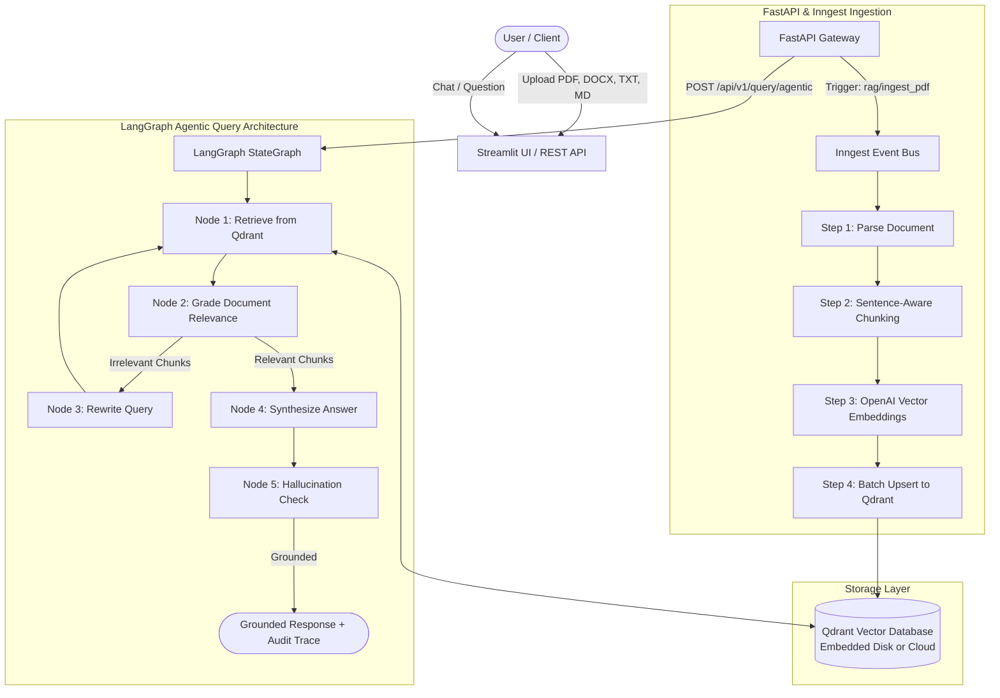

# ⚡ Enterprise Event-Driven RAG Agent Application

[](https://www.python.org/)
[](https://fastapi.tiangolo.com/)
[](https://langchain-ai.github.io/langgraph/)
[](https://www.inngest.com/)
[](https://qdrant.tech/)
[](https://openai.com/)
[](https://streamlit.io/)

A production-grade, event-driven **Retrieval-Augmented Generation (RAG)** application engineered for high reliability, fault tolerance, and multi-format document reasoning. Built with **FastAPI**, **LangGraph** (Corrective RAG with self-reflection), **Inngest** durable workflows, **Qdrant** vector search, and a modern **Streamlit** user interface.

---

## 🏗️ Architecture Overview

The system decouples ingestion and retrieval into durable, observable workflows using Inngest event orchestration alongside an embedded or cloud-native Qdrant vector store.



---

## ✨ Key Features

- 🔄 **Durable Workflow Orchestration**: Powered by [Inngest](https://www.inngest.com/), featuring automatic retries, per-document rate limiting, and step memoization.
- 📦 **Zero-Docker Dual-Mode Qdrant**:
  - **Embedded Disk Mode (`local`)**: Runs directly on local disk storage in `./qdrant_storage` without needing Docker or external processes.
  - **Remote / Cloud Mode (`remote`)**: Seamlessly points to Qdrant Cloud or a Docker container via `QDRANT_URL` and `QDRANT_API_KEY`.
- 📄 **Multi-Format Ingestion**: Ingests **PDFs**, **Word documents (`.docx`)**, **Markdown (`.md`)**, and **Plain Text (`.txt`)** with page and section metadata tracking.
- 🎯 **Accurate Grounded Citations**: Answers include exact source document names, chunk indexes, and cosine similarity relevance percentages.
- 💻 **Modern Streamlit Studio**: Conversational chat interface with persistent session history, multi-file drag-and-drop, and an interactive vector payload inspector.
- 🚀 **RESTful API**: Clean FastAPI endpoints with interactive Swagger documentation (`/docs`), health checks (`/health`), and document management.

---

## 📁 Project Structure

```
RAG_AGENT_APP/
├── config.py                 # Centralized configuration & environment loader
├── custom_types.py           # Pydantic schemas (chunks, citations, queries, agent steps)
├── data_loader.py            # Multi-format doc parser (PDF, DOCX, TXT, MD) & embedder
├── vector_db.py              # Production Qdrant storage manager (local embedded & remote)
├── rag_graph.py              # LangGraph Agentic RAG engine (CRAG & self-reflection)
├── main.py                   # FastAPI application + Inngest durable workflows
├── streamlit_app.py          # Modern Streamlit chat studio & document inspector
├── pyproject.toml            # Project packaging & metadata
├── requirements.txt          # Pinned dependency requirements
├── .env.example              # Environment variables template
├── uploads/                  # Temporary document upload directory
├── qdrant_storage/           # Local Qdrant embedded collection storage
└── README.md                 # Complete system documentation
```

---

## 🚀 Quickstart Guide

### 1. Prerequisites
- Python 3.11, 3.12, or 3.13
- Node.js & npm (optional, only needed for the Inngest local dev server)
- An [OpenAI API Key](https://platform.openai.com/)

### 2. Environment Setup

Clone or open the repository, then create a virtual environment:

```bash
# Create virtual environment
python -m venv .venv

# Activate on Windows (PowerShell)
.\.venv\Scripts\Activate.ps1

# Activate on macOS / Linux
source .venv/bin/activate
```

Install the dependencies:

```bash
pip install -r requirements.txt
```

### 3. Configure Environment Variables

Copy the `.env.example` template to `.env`:

```bash
cp .env.example .env
```

Open `.env` and configure your OpenAI API key:

```ini
OPENAI_API_KEY=sk-proj-your-openai-api-key-here
QDRANT_MODE=local
OPENAI_LLM_MODEL=gpt-4o-mini
OPENAI_EMBED_MODEL=text-embedding-3-large
```

---

## 🏃 Running the Application

### Option A: Launch the Streamlit Studio (Quickest)

You can launch the full interactive web UI immediately:

```bash
streamlit run streamlit_app.py
```

- Open [http://localhost:8501](http://localhost:8501) in your browser.
- Go to the **"Ingest Documents"** tab to drag and drop your PDFs, Word documents, or text files.
- Switch to the **"Ask & Chat"** tab to ask questions and view grounded citations!

---

### Option B: Launch Full Inngest Orchestration & FastAPI Backend

For complete event-driven background processing and REST API support:

1. **Start the FastAPI Backend**:
   ```bash
   uvicorn main:app --reload --port 8000
   ```
   API Swagger Docs will be available at [http://localhost:8000/docs](http://localhost:8000/docs).

2. **Start the Inngest Dev Server**:
   ```bash
   npx inngest-cli@latest dev -u http://127.0.0.1:8000/api/inngest
   ```
   Open the Inngest Dev Dashboard at [http://localhost:8288](http://localhost:8288) to monitor events, steps, and execution timelines in real-time.

3. **Start the Streamlit Frontend**:
   ```bash
   streamlit run streamlit_app.py
   ```
   Enable the **"Use Inngest Dev Server"** toggle in the sidebar to route queries through the distributed event bus.

---

## 🔌 API Reference

| Method | Endpoint | Description |
| :--- | :--- | :--- |
| `GET` | `/health` | System health check and Qdrant storage status |
| `GET` | `/api/v1/stats` | Total indexed vectors and list of document sources |
| `POST` | `/api/v1/upload` | Direct multipart document upload and vectorization |
| `POST` | `/api/v1/query` | Direct semantic search and LLM answer generation |
| `DELETE` | `/api/v1/documents/{source_id}` | Removes all chunks belonging to a document |

---

## ⚙️ Configuration Reference

| Environment Variable | Default | Description |
| :--- | :--- | :--- |
| `OPENAI_API_KEY` | *(Required)* | OpenAI API secret key |
| `OPENAI_LLM_MODEL` | `gpt-4o-mini` | LLM used for answering queries (`gpt-4o`, `gpt-4o-mini`) |
| `OPENAI_EMBED_MODEL` | `text-embedding-3-large` | Embedding model (`text-embedding-3-large`, `text-embedding-3-small`) |
| `EMBEDDING_DIM` | `3072` | Vector dimensionality (3072 for large, 1536 for small) |
| `QDRANT_MODE` | `local` | `local` (embedded disk) or `remote` (server / cloud) |
| `QDRANT_STORAGE_PATH` | `./qdrant_storage` | Directory path for embedded Qdrant database |
| `QDRANT_URL` | `http://localhost:6333` | Remote Qdrant server URL |
| `CHUNK_SIZE` | `1000` | Target character size per chunk |
| `CHUNK_OVERLAP` | `200` | Overlap between adjacent chunks |
| `DEFAULT_TOP_K` | `5` | Default number of context chunks retrieved |

---

## 🛡️ License

Distributed under the MIT License. See `LICENSE` for more information.
